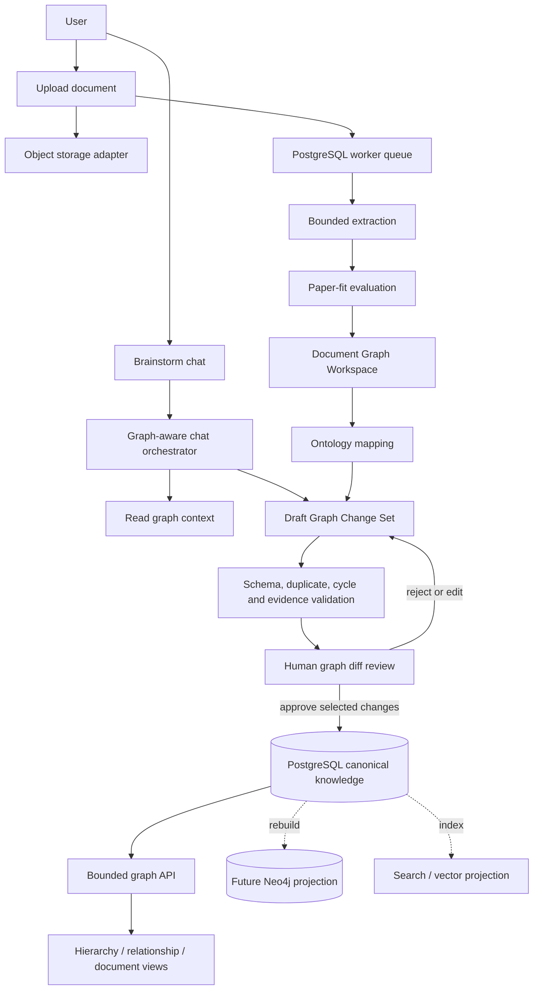

# Business AI Agents Graph Intelligence Upgrade Plan

## 0. Document status

- Status: accepted for phased implementation with the defaults in section 25.
- Date: 2026-07-18.
- Owner: Linh / Research System.
- Scope: paper-fit evaluation, document-scoped graph, parent-child visualization, canonical Business AI Agents ontology, and brainstorm chatbot-to-graph workflow.
- Implementation authorization: this document defines the work; it does not authorize code implementation by itself.
- Related documents:
  - `Research System MVP Specification.md`
  - `Research System Implementation Plan.md`
  - `Research System Completion Plan.md`
  - `Research System Architecture Design.md`
  - `Research System Brainstorm.md`
  - `Business model AI agent document.md`

## 1. Executive summary

The upgrade introduces **Graph Intelligence v2** as three coordinated graph layers:

1. **Canonical Business AI Agents Graph**: accepted system knowledge and its stable ontology.
2. **Document Graph Workspace**: an isolated draft graph extracted from each uploaded document.
3. **Graph Change Set Layer**: reviewable mutations proposed by document analysis or chatbot sessions.

The product must not treat the entire knowledge graph as a tree. It provides:

- a hierarchy view for direct parent-child taxonomy and document containment;
- a relationship view for many-to-many semantic, evidence, citation, implementation, and business links;
- a document view for one uploaded source;
- a graph diff view for proposed changes.

PostgreSQL remains the source of truth. The graph API and any future Neo4j database remain rebuildable projections. AI may propose nodes, edges, aliases, evidence, and merges, but it may not directly publish or overwrite accepted human knowledge.

## 2. Goals

### 2.1. Product goals

- Give AI a stable frame for deciding whether a paper is relevant to Business AI Agents.
- Explain where a paper belongs in the system and why.
- Build a separate, inspectable graph for every uploaded document.
- Let users click any node to inspect its summary, children, relationships, evidence, and provenance.
- Add an explicit parent-child view without losing cross-graph relationships.
- Establish a canonical top-level Business AI Agents concept scheme.
- Let users brainstorm through chat and convert useful ideas into reviewable graph changes.
- Preserve provenance, confidence, evidence location, AI model, prompt version, and review history.
- Prevent duplicate concepts, unsupported edges, hierarchy cycles, and silent AI overwrites.

### 2.2. Technical goals

- Extend the existing `{nodes, edges, meta}` graph contract without breaking current clients.
- Use additive PostgreSQL migrations first.
- Keep provider-specific AI code behind interfaces.
- Support OpenAI Responses API function calling for chatbot tools while retaining the existing provider registry.
- Keep document and chat jobs retryable and observable through the existing worker pattern.
- Make accepted graph state rebuildable into Neo4j later.

## 3. Non-goals for the first release

- Autonomous publication of AI-generated knowledge.
- General-purpose web-scale ontology building.
- Automatic deletion of accepted nodes or edges.
- Full RDF/OWL reasoning engine.
- Making Neo4j the canonical database.
- Universal OCR, paywall bypass, private-source scraping, or unrestricted file processing.
- Allowing the model to call a `publish` or `commit` tool directly.

## 4. Locked constraints inherited from the current system

- PostgreSQL is the source of truth.
- Search and graph are rebuildable projections.
- Only approved knowledge appears in the published graph by default.
- AI outputs are suggestions and do not overwrite human fields.
- Provider output is validated against structured schemas.
- API routes remain under `/api/v1`.
- API keys come only from environment configuration and never appear in API responses or logs.
- Incomplete extraction remains explicit as `partial_success` or a typed failure.
- Existing `ResearchItem` lifecycle and versioning remain valid.

## 5. Current-state gap analysis

| Capability | Current state | Required upgrade |
|---|---|---|
| Graph contract | Typed nodes, edges, confidence, evidence list, bounded queries | Add workspace, hierarchy, lifecycle, child count, provenance and mutation metadata |
| Node detail | Summary, confidence, source count, relations | Add children, evidence, provenance, aliases, change history and actions |
| Ontology | Node types and flat extracted labels | Stable top-level concept scheme plus canonical IDs and aliases |
| Hierarchy | No explicit parent-child relation | Direct hierarchy edges, cycle checks, breadcrumb and lazy children API |
| Document upload | URL/PDF intake and attachment metadata | Durable binary storage contract and per-document graph workspace |
| Paper evaluation | Generic classification/evaluation | Business AI Agents paper-fit rubric with placement and evidence |
| Merge workflow | Research approval | Graph change-set review with per-mutation decisions |
| Chat | No graph-aware brainstorm workspace | Provider-neutral chat with read/propose tools and local audit history |
| Neo4j | Explicit adapter scaffold | Remains later projection; not required for v2 MVP |

Status update (2026-07-21): the v2 MVP correctly shipped without requiring Neo4j. Gate C follow-up
has since implemented and verified the optional idempotent relationship/hierarchy projection on a
real disposable Neo4j server. PostgreSQL remains canonical; automatic sync is still deferred.

## 6. Target architecture



### 6.1. Write boundaries

- Upload extraction writes only to a document workspace and AI provenance records.
- Chat tools write only to a draft change set.
- Validation can mark a mutation valid, warning, conflict, or invalid.
- Only the approval service writes accepted canonical nodes and edges.
- Projection rebuilds never alter canonical knowledge.

### 6.2. Graph views

| View | Purpose | Included edges |
|---|---|---|
| `relationship` | Explore the knowledge network | All accepted semantic edges within query limits |
| `hierarchy` | Browse parent-child ontology | Direct `BROADER_THAN` or `PARENT_OF` structure plus a read-only overlay of accepted semantic edges whose endpoints are visible |
| `document` | Inspect one source | Document containment plus extracted source relations |
| `diff` | Review proposed changes | Canonical context plus added, changed, merged and rejected mutations |

The research graph uses progressive disclosure rather than giving every element equal visual
weight. Relationship overview keeps the complete bounded corpus but applies semantic zoom: node
importance controls glyph size, and selecting a node emphasizes its direct neighborhood
while muting unrelated structure. Hover stays local to the pointed node or edge so pointer movement
does not repaint the complete SVG corpus. Network labels use one uniform rule: all are hidden at
rest and only the currently hovered or keyboard-focused node shows a compact badge with its explicit
human-readable type above its name. The hierarchy overview draws approved nodes that
participate in parent/child structure and explicitly reports approved-but-unplaced nodes instead of
shrinking hundreds of disconnected roots into an unreadable fit. Search and focused branch queries
can still surface an unplaced node. Large shallow forests use a multi-column branch atlas and open
at a readable pan/zoom scale. Dense hierarchy parents preview a bounded set of direct leaf children;
the remaining leaves stay hidden until that parent is expanded, without changing canonical data.

The primary `/graph` workspace presents these semantics through three GitNexus-inspired visual
layouts: Network for type-clustered force exploration, Hierarchy for progressive board/card
browsing, and Orbit for a deterministic concentric overview. Hierarchy keeps structural edges solid
and draws visible semantic cross-relations as distinct dashed links, so switching to the relationship
network is no longer required just to discover that two displayed cards are related. The workspace
uses a clean light canvas with compact node glyphs and control icons; invisible minimum-size hit
targets preserve comfortable mouse and touch selection independently of glyph size. Network hover
changes only the pointed glyph and label (or edge), with no root focus state, inherited cursor write
or SVG filter repaint. Overview connections remain as faint dashed orientation lines; hovering a
node reveals only its pre-indexed direct connections as clear solid lines. Intentional click
selection uses the same pre-indexed adjacency and incident-edge sets:
one root focus class dims the corpus, while only the previous/current focus neighborhood receives
direct DOM class updates. The initial force layout is settled once before display and remains stopped,
so no force ticks or delayed fit animations compete with pointer interaction.

Network community halos stay behind the graph, but their compact type/count headings render in the
dedicated foreground label layer with a subtle canvas-colored outline. Overlapping community nodes
therefore cannot cover the heading text, and the headings remain pointer-transparent so node hover,
selection and drag behavior are unchanged.

Hierarchy opens at a readable progressive scale, while the explicit `Fit view` action is a strict
whole-graph overview: every rendered card is contained inside the current canvas on desktop,
tablet and mobile, even when the resulting overview scale is smaller than the normal reading
scale. The zoom indicator follows the actual D3 transform, resize work is animation-frame
coalesced, and hierarchy hover updates only the pointed card plus its pre-indexed incident edges;
it does not scan the whole SVG or create pointer-time transitions.

Concurrent read scaling is layered rather than delegated to the renderer alone. The browser keeps
graph queries fresh for a short bounded interval, deduplicates repeated neighbor expansion and does
not refetch just because window focus changes. The workspace derives connected-component and node
type statistics from the already loaded relationship projection instead of issuing another full
projection request. Large API JSON is privately cacheable and compressed. The opt-in multi-user
runtime uses multiple Uvicorn workers, explicit PostgreSQL pool budgets and a production Next.js
server; multi-host deployments still require an external load balancer and shared rate limiter.

The primary `/graph` surface opts out of the shared reading-page width cap and uses responsive
viewport-relative gutters. At wide desktop sizes the studio occupies at least 95% of the viewport,
while its canvas grows with the available height; other research, document and change-review pages
retain their narrower reading width. Tablet/mobile padding and zero-horizontal-overflow behavior
remain part of the graph contract.

The primary graph keeps visible copy task-oriented. Repeated introductory prose, hierarchy
explanation banners, the canvas guide card and the persistent interaction sentence are omitted;
toolbar labels, node labels, compact graph counts, loading/empty/error states and operational safety
warnings remain. Hierarchy disclosure is summarized in the compact canvas status rather than in
full-width notices.

The separate Business AI Agents system-map hierarchy uses folding compound boards. Its initial canvas renders the system root and
collapsed top-level pillar boards only. A board shows its direct-node count; clicking it expands
that same board into a group container whose direct child nodes are laid out inside its boundary.
Other boards stay visible and collapsed so the user's mental map is preserved. Folding changes only
the visible projection: canonical nodes, parent relationships and approval governance are unchanged.
Every system-map card shows its real human-readable node type; a pillar is labelled `System Pillar`,
not the generic visual role `Board`.

System-map card shapes remain in the interactive node layer, while their visible type, title,
board-action and child-count text is mirrored into the pointer-transparent foreground label layer.
The source text stays available inside the accessible card group but is not double-painted. A subtle
canvas-colored outline keeps the foreground copy readable above compound parent cards or any
accidental node overlap without changing folding, containment, selection or keyboard behavior.

## 7. Canonical Business AI Agents concept scheme

### 7.1. Top-level pillars

The seed ontology begins with one root and eleven stable pillars:

```text
Business AI Agents
├── Business Problems & Outcomes
├── Business Context
├── Agent System Architecture
├── Agent Capabilities & Workflows
├── Business Methods & Decision Intelligence
├── Data, Knowledge & Memory
├── Tools, Functions & Integrations
├── Outputs, Actions & Feedback
├── Evaluation, Risk & Governance
├── Engineering & Operations
└── Research & Evidence
```

### 7.2. Initial second-level taxonomy

#### Business Problems & Outcomes

- Revenue growth
- Cost reduction
- Operational control
- Decision quality
- Customer experience
- Risk reduction
- Business scalability
- Owner workload reduction

#### Business Context

- Organization
- Industry
- Business model
- Product and service
- Customer segment
- Sales channel
- Competitor
- Market
- Regulation and policy

#### Agent System Architecture

- Orchestrator Agent
- Business Model Agent
- Marketing and Sales Agent
- Finance and Pricing Agent
- Operations Agent
- Legal and Tax Assistant
- Research Agent
- Data Quality Agent
- Evaluator and Critic Agent
- Single-agent architecture
- Multi-agent architecture
- Human-in-the-loop architecture

#### Agent Capabilities & Workflows

- Intent classification
- Planning
- Reasoning
- Retrieval
- Tool use
- Delegation
- Reflection and critique
- Escalation
- Workflow execution
- Notification
- Learning from feedback

#### Business Methods & Decision Intelligence

- Business Model Canvas
- SWOT
- PESTEL
- Five Forces
- Value Chain
- STP
- Customer journey
- Unit economics
- Break-even analysis
- Pricing analysis
- Forecasting
- Scenario planning
- Decision scoring

#### Data, Knowledge & Memory

- Data ingestion
- Data normalization
- Data quality
- Knowledge base
- Knowledge graph
- Retrieval-augmented generation
- Embeddings and vector search
- Short-term memory
- Long-term memory
- Episodic memory
- Semantic memory
- Enterprise memory map

#### Tools, Functions & Integrations

- Calculation function bank
- CRM integration
- Accounting integration
- Spreadsheet processing
- Database access
- Web search
- File processing
- Messaging integration
- Scheduling
- Report generation

#### Outputs, Actions & Feedback

- Insight
- Recommendation
- Assumption
- Risk
- Decision
- Task
- Alert
- Report
- Expected result
- Actual result
- User feedback

#### Evaluation, Risk & Governance

- Confidence
- Evidence quality
- Hallucination control
- Agent evaluation
- Tool-call evaluation
- Privacy and PII
- Security
- Legal and tax safety
- Human approval
- Provenance
- Audit trail
- Policy compliance

#### Engineering & Operations

- Model provider
- Prompt management
- Agent orchestration framework
- API
- Background job
- Deployment
- Observability
- Latency
- Cost
- Reliability
- Backup and recovery

#### Research & Evidence

- Paper
- Article
- Repository
- Case study
- Claim
- Method
- Dataset
- Experiment
- Metric
- Finding
- Limitation
- Citation
- Knowledge gap

### 7.3. Node types versus ontology placement

Node type and hierarchy placement are separate concerns:

- `type` answers: “What is this node?”
- `primary_parent_id` answers: “Where is it displayed in the main hierarchy?”
- semantic edges answer: “How is it related to other knowledge?”

Existing types remain valid:

- `ResearchItem`
- `Concept`
- `Technology`
- `AgentPattern`
- `BusinessDomain`
- `Person`
- `CollectorSource`
- `ResearchGap`

New v2 types:

- `SystemPillar`
- `BusinessOutcome`
- `AgentRole`
- `AgentCapability`
- `BusinessMethod`
- `ToolFunction`
- `DataAsset`
- `DecisionObject`
- `RiskControl`
- `EvidenceClaim`
- `DocumentSection`
- `Method`
- `Dataset`
- `Finding`
- `Limitation`
- `Metric`
- `Citation`

### 7.4. Canonical naming and aliases

Each canonical node has:

- one stable UUID;
- one canonical English label;
- one optional canonical Vietnamese label;
- normalized aliases;
- a definition and scope note;
- one preferred display parent;
- zero or more secondary classification edges.

Normalization must not merge nodes on string similarity alone. A candidate can be:

- `MATCH_EXISTING`
- `CREATE_NEW`
- `ADD_ALIAS`
- `RELATED_BUT_DISTINCT`
- `NEEDS_REVIEW`

## 8. Edge vocabulary

### 8.1. Hierarchy and containment edges

- `BROADER_THAN`
- `NARROWER_THAN`
- `PARENT_OF`
- `CHILD_OF`
- `CONTAINS`
- `PART_OF`

Only direct hierarchy edges are stored. Ancestor and descendant paths are computed during queries. A hierarchy edge must not create a cycle.

### 8.2. Research and evidence edges

- `RESEARCHES`
- `AUTHORED_BY`
- `COLLECTED_FROM`
- `CITES`
- `REFERENCES`
- `EXTENDS`
- `SUPPORTS`
- `CONTRADICTS`
- `REQUIRES`
- `REVIEWS`
- `IS_VERSION_OF`
- `IS_DERIVED_FROM`
- `FILLS_GAP`
- `SYNTHESIZED_INTO`

### 8.3. Business AI Agents edges

- `APPLIES_TO`
- `ACHIEVES_OUTCOME`
- `IMPLEMENTS_PATTERN`
- `HAS_CAPABILITY`
- `PERFORMS_WORKFLOW`
- `USES_TECH`
- `USES_TOOL`
- `USES_METHOD`
- `CONSUMES_DATA`
- `PRODUCES_OUTPUT`
- `EVALUATED_BY`
- `MITIGATES_RISK`
- `GOVERNED_BY`
- `DEPENDS_ON`
- `RELATED_TO`

### 8.4. Edge invariants

- Edge source and target must exist in the same visible workspace or in the canonical graph.
- Self-loops are rejected unless a future explicit edge type permits them.
- Hierarchy cycles are rejected.
- `RELATED_TO` cannot replace a more precise known relation.
- Every AI-proposed semantic edge must have confidence and at least one evidence record, except explicit user-authored brainstorm ideas marked `evidence_pending`.
- Accepted edges are immutable in place for audit purposes; material edits create a new version or superseding relation.

## 9. Paper Fit & Placement Framework

### 9.1. Hard gates

Before scoring, the pipeline checks:

- supported and lawful source access;
- readable content or useful metadata;
- content hash and canonical-identifier duplicate status;
- required title and source provenance;
- supported language or available translation path;
- no known malware or disallowed file type;
- content is not empty, corrupt, or only navigation noise.

If a hard gate fails, the item does not receive a misleading fit score.

### 9.2. Weighted score

| Dimension | Weight | Definition |
|---|---:|---|
| System fit | 25 | Direct relevance to one or more canonical Business AI Agents pillars |
| Business applicability | 20 | Applicability to business problems, domains, workflows or outcomes |
| Evidence quality | 15 | Method rigor, evidence strength, clarity and reproducibility |
| Novelty | 15 | New knowledge relative to the current approved KB |
| Implementation value | 10 | Architecture, workflow, code, evaluation or actionable method |
| Gap coverage | 10 | Contribution to a known low-coverage concept or research gap |
| Freshness | 5 | Current validity of time-sensitive claims and technology details |

Formula:

```text
fit_score =
  system_fit * 0.25 +
  business_applicability * 0.20 +
  evidence_quality * 0.15 +
  novelty * 0.15 +
  implementation_value * 0.10 +
  gap_coverage * 0.10 +
  freshness * 0.05
```

### 9.3. Decision bands

| Score | Routing | Meaning |
|---:|---|---|
| 0-39 | `not_relevant` | Build an isolated document graph, but do not propose canonical promotion by default |
| 40-59 | `watch` | Build an isolated document graph; require manual routing before canonical promotion |
| 60-79 | `draft_graph` | Build document graph and route to normal review |
| 80-100 | `priority_review` | Build document graph and prioritize graph mapping review |

Duplicate confidence greater than or equal to the configured hard threshold routes to duplicate review regardless of fit score.
Paper-fit controls routing and promotion priority, not whether readable source material receives an
isolated graph for inspection.

### 9.4. Structured output contract

```json
{
  "fit_score": 84.2,
  "decision": "priority_review",
  "dimensions": {
    "system_fit": 92,
    "business_applicability": 85,
    "evidence_quality": 78,
    "novelty": 74,
    "implementation_value": 90,
    "gap_coverage": 80,
    "freshness": 88
  },
  "matched_pillars": ["Agent System Architecture"],
  "candidate_parents": ["Multi-agent architecture"],
  "contribution_types": ["architecture", "evaluation"],
  "overlaps_with": [],
  "fills_gaps": [],
  "limitations": [],
  "reasoning_summary": "",
  "confidence": 0.88
}
```

### 9.5. Evaluation requirements

Build a versioned gold set with at least:

- 10 clearly core papers;
- 10 enabling-technology papers;
- 10 tangential or irrelevant papers;
- duplicate and near-duplicate pairs;
- old foundational papers and recent implementation papers;
- papers with strong methodology but low business relevance;
- papers with high business relevance but weak evidence.

Target metrics for release:

- priority/draft routing precision at least 0.85 on the gold set;
- top-three ontology placement recall at least 0.85;
- duplicate recall at least 0.90;
- invalid structured-output rate below 1% after bounded retry;
- zero automatic publication from evaluation alone.

## 10. Document Graph Workspace

### 10.1. Lifecycle

```text
uploaded
  -> extracting
  -> evaluating
  -> graph_building
  -> needs_review
  -> partially_merged | merged | rejected

Any processing state
  -> failed
  -> manual retry
```

Processing status and review status remain separate.

### 10.2. Document graph structure

```text
Document
├── Section
│   ├── Claim
│   │   ├── Evidence
│   │   └── Limitation
│   ├── Method
│   ├── Dataset
│   ├── Metric
│   └── Finding
├── Concept
├── Technology
├── Agent Pattern
├── Business Use Case
└── Citation
```

### 10.3. Evidence location

Every extracted node or edge should point to one or more locations:

- source document ID;
- page number when available;
- section heading;
- paragraph or character offsets;
- table or figure identifier;
- bounded supporting excerpt;
- extraction method;
- content hash.

The UI must display evidence without requiring the user to trust the summary alone.

The node inspector presents a source-grounded summary capped at 200 characters. A researcher can
request bounded independent AI research for one node or all eligible semantic nodes. The result is
stored with provider/model provenance and classifies the comparison as `consistent`, `different`,
or `insufficient`; material differences are stated explicitly. Choosing promotion creates or
updates a draft change set only and never writes directly to the canonical graph.

### 10.4. File storage contract

Introduce an `ObjectStorage` interface:

```python
class ObjectStorage(Protocol):
    async def put(self, key: str, stream: AsyncIterator[bytes], metadata: dict) -> StoredObject: ...
    async def open(self, key: str) -> AsyncIterator[bytes]: ...
    async def delete(self, key: str) -> None: ...
```

Initial local-first implementation:

- store outside the repository in a configurable application data directory;
- generate server-side object keys;
- stream uploads with byte limits;
- verify MIME type and extension consistency;
- calculate SHA-256 during upload;
- never expose internal filesystem paths;
- retain an adapter boundary for MinIO.

Proposed initial configuration, subject to product-owner approval:

- PDF, DOCX, UTF-8 plain text, Markdown, LaTeX, reStructuredText, AsciiDoc and HTML only;
- 20 MB default maximum per file;
- configurable limits through environment variables;
- scanned PDF remains `partial_success` until OCR is enabled.

## 11. Ontology mapping and merge workflow

### 11.1. Candidate generation

For each extracted node:

1. Normalize the label and aliases.
2. Search exact canonical labels and aliases.
3. Retrieve semantic candidates from approved nodes.
4. Retrieve candidate parents from the relevant pillar.
5. Ask the model for a typed mapping decision.
6. Validate the decision in code.
7. Add the proposal to a graph change set.

### 11.2. Mapping decision schema

```json
{
  "source_node_id": "document-node-id",
  "action": "MATCH_EXISTING",
  "target_node_id": "canonical-node-id",
  "canonical_label": "Agent Memory",
  "primary_parent_id": "data-knowledge-memory-id",
  "secondary_parent_ids": [],
  "aliases": ["AI Agent Memory"],
  "confidence": 0.93,
  "evidence_ids": ["evidence-id"],
  "reasoning_summary": ""
}
```

### 11.3. Change-set lifecycle

```text
draft
  -> validating
  -> needs_review
  -> approved | partially_approved | rejected
  -> applied
```

Mutation operations:

- `CREATE_NODE`
- `UPDATE_NODE`
- `ADD_ALIAS`
- `CREATE_EDGE`
- `UPDATE_EDGE`
- `MERGE_NODE`
- `SUPERSEDE_EDGE`

Delete is excluded from v2 MVP. A user can reject or archive knowledge through an explicit later workflow.

### 11.4. Review behavior

The review UI must allow:

- accept/reject all;
- accept/reject one mutation;
- edit label, type, parent or edge type;
- compare candidate duplicates;
- inspect evidence in context;
- see validation warnings;
- re-run mapping for selected items;
- undo an applied change set by creating a compensating change set.

## 12. Chatbot-to-graph design

### 12.1. Product behavior

Each chat turn produces:

1. a normal brainstorm response;
2. zero or more graph mutation proposals;
3. a visible “Knowledge changes” card.

The user can:

- add proposals to a draft graph;
- accept selected changes;
- edit before accepting;
- reject all;
- ask the chatbot to explain placement;
- view a graph diff;
- undo through a compensating change set.

### 12.2. Chat scope

A session can be scoped to:

- the entire canonical graph;
- one system pillar;
- one canonical node and its neighborhood;
- one uploaded document;
- one graph change set;
- one research gap.

Only bounded context is retrieved for each turn.

### 12.3. Provider-neutral orchestration

Introduce a provider capability boundary:

```python
class GraphChatProvider(Protocol):
    async def respond(
        self,
        messages: list[ChatMessage],
        tools: list[ToolDefinition],
        response_schema: type[BaseModel],
        context: GraphContext,
    ) -> GraphChatResult: ...
```

- OpenAI adapter: Responses API with strict function tools and structured response output.
- DeepSeek adapter: Chat Completions native tool calling in non-thinking mode with application-side
  schema validation and the same governed tool loop.
- Other providers: native tool calling where supported, otherwise validated `GraphChangeProposal` structured output.
- The orchestration and approval rules remain provider-neutral.

### 12.4. Initial tool set

Read tools:

- `search_graph`
- `get_node_context`
- `get_children`
- `get_document_evidence`
- `find_similar_nodes`

Proposal tools:

- `propose_node`
- `propose_edge`
- `propose_alias`
- `propose_merge`
- `attach_evidence`
- `create_change_set`

The model is not given:

- `publish_change_set`
- `delete_node`
- `delete_edge`
- raw SQL or unrestricted database access
- unrestricted filesystem or network access

### 12.5. OpenAI Responses integration

Implementation rules:

- define tools with JSON Schema and strict validation;
- validate all tool arguments with Pydantic before execution;
- execute tools on the application side;
- return tool results using the matching call ID;
- handle zero, one or multiple tool calls;
- cap tool-call loops per turn;
- stream user-visible response text separately from mutation status;
- record request ID, provider, model, prompt version and usage metadata without secrets;
- use `store: false` by default for business-sensitive sessions;
- persist the product conversation and summaries locally in PostgreSQL;
- send only bounded, authorized context to the provider.

OpenAI references:

- Function calling: <https://developers.openai.com/api/docs/guides/function-calling>
- Structured Outputs: <https://developers.openai.com/api/docs/guides/structured-outputs>
- Conversation state: <https://developers.openai.com/api/docs/guides/conversation-state>

### 12.6. Chat safety and governance

- AI-generated facts without sources are marked `evidence_pending`.
- Business-sensitive content is redacted according to a configurable policy before cloud-provider calls.
- Chat cannot publish a mutation.
- User identity and approval identity are captured after auth/RBAC exists.
- Before RBAC, the local MVP approval endpoint represents the local authorized owner, matching the existing research approval model.
- Prompt injection inside uploaded documents is treated as document content, not system instruction.
- Tool descriptions explicitly state when not to create a node.

## 13. Data model

### 13.1. New tables

#### `knowledge_nodes`

| Column | Notes |
|---|---|
| `id` | UUID primary key |
| `node_type` | Controlled enum/string |
| `canonical_label` | Required |
| `label_vi` | Optional |
| `normalized_key` | Indexed candidate-dedup key |
| `description` | Human-approved definition |
| `scope_note` | Inclusion/exclusion guidance |
| `primary_parent_id` | Nullable self-reference |
| `lifecycle_status` | draft, approved, archived |
| `created_by_type` | human, ai_proposal, migration |
| `created_by_ref` | User/change-set/provenance reference |
| timestamps | Created and updated timestamps |

Constraints:

- unique approved `normalized_key` within node type when semantically appropriate;
- `primary_parent_id != id`;
- cycle validation in service code and recursive query;
- archived nodes excluded from default projection.

#### `knowledge_edges`

| Column | Notes |
|---|---|
| `id` | UUID primary key |
| `source_node_id` | Required |
| `target_node_id` | Required |
| `edge_type` | Controlled vocabulary |
| `confidence` | 0-1 |
| `lifecycle_status` | draft, approved, superseded, archived |
| `evidence_status` | supported, evidence_pending, disputed |
| `version` | Optimistic/version history support |
| provenance fields | Creator/change-set references |

#### `concept_aliases`

- `id`
- `knowledge_node_id`
- `alias`
- `normalized_alias`
- `language`
- `alias_type`: synonym, acronym, former_name, spelling
- provenance and lifecycle fields

#### `document_graph_workspaces`

- `id`
- `research_id` or `link_submission_id`
- `attachment_id`
- `storage_object_key`
- `content_hash`
- processing status
- review status
- fit evaluation ID
- extraction limitations
- timestamps

#### `document_graph_nodes`

- workspace ID
- local node ID
- node type
- label and summary
- document parent ID
- canonical candidate ID
- confidence
- evidence status
- extraction provenance

#### `document_graph_edges`

- workspace ID
- source local/canonical reference
- target local/canonical reference
- edge type
- confidence
- mapping status

#### `node_evidence`

- owner kind and owner ID
- source document/workspace ID
- page, section, paragraph and offsets
- excerpt
- content hash
- extraction method
- created-by provenance

#### `paper_evaluations`

- research or submission ID
- rubric version
- dimension scores
- fit score
- decision
- matched pillars and candidate parents
- overlap and gap results
- provider/model/prompt/input-hash provenance

#### `graph_change_sets`

- origin type: document, chat, manual, migration
- origin ID
- title and summary
- lifecycle status
- validation summary
- creator/approver references
- applied timestamp

#### `graph_mutations`

- change-set ID
- operation
- target node/edge ID
- before JSON
- proposed JSON
- validation status and messages
- review decision and edits
- order within change set

#### `chat_sessions`

- title
- scope type and scope ID
- provider/model
- local conversation summary
- status
- optional immutable source type, public shared URL, snapshot hash, import time and message count
- created/updated timestamps

#### `chat_messages`

- session ID
- role
- content
- provider response ID when applicable
- tool calls/results JSON with secret filtering
- linked change-set ID
- token/latency metadata
- message origin (`local` or imported public ChatGPT snapshot)

### 13.2. Existing model relationships

- `ResearchItem` remains the canonical research document.
- A research item can have zero or more document graph workspaces across versions/attachments.
- Accepted research-to-concept links become approved knowledge edges.
- Existing tags remain readable during migration and are not deleted.
- Existing `ResearchRelation` rows remain compatible and can be projected as approved research edges.

### 13.3. Migration strategy

1. Add new tables and optional graph response fields.
2. Seed the root and top-level pillars with deterministic IDs.
3. Seed approved second-level concepts.
4. Backfill existing tags/classification labels as mapping candidates, not silent canonical merges.
5. Preserve the existing graph projection while v2 APIs are behind a feature flag.
6. Compare v1 and v2 graph counts and research visibility.
7. Switch the default projector only after parity and acceptance tests pass.
8. Keep downgrade safe for schema additions; never delete existing research/tag data during rollout.

## 14. API plan

### 14.1. Ontology

```text
GET    /api/v1/ontology
GET    /api/v1/ontology/nodes/{id}
GET    /api/v1/ontology/nodes/{id}/children
GET    /api/v1/ontology/search?q=
POST   /api/v1/ontology/validate-placement
```

### 14.2. Graph v2 reads

Extend the current endpoints without removing them:

```text
GET /api/v1/graph?view=relationship|hierarchy|document|diff
GET /api/v1/graph/node/{id}
GET /api/v1/graph/node/{id}/children
GET /api/v1/graph/node/{id}/evidence
GET /api/v1/graph/ego/{id}
GET /api/v1/graph/path
```

New optional node response fields:

```json
{
  "primary_parent_id": null,
  "child_count": 0,
  "workspace_id": null,
  "lifecycle_status": "approved",
  "aliases": [],
  "provenance": {},
  "evidence_count": 0
}
```

### 14.3. Document upload and graph

```text
POST   /api/v1/documents
GET    /api/v1/documents/{id}
GET    /api/v1/documents/{id}/content
POST   /api/v1/documents/{id}/analyze
POST   /api/v1/documents/{id}/retry
GET    /api/v1/documents/{id}/graph
POST   /api/v1/documents/{id}/graph/research
GET    /api/v1/documents/{id}/evaluation
POST   /api/v1/documents/{id}/create-change-set
```

### 14.4. Change sets

```text
GET    /api/v1/graph/change-sets
GET    /api/v1/graph/change-sets/{id}
POST   /api/v1/graph/change-sets/{id}/validate
POST   /api/v1/graph/change-sets/{id}/mutations/{mutation_id}/decision
POST   /api/v1/graph/change-sets/{id}/approve
POST   /api/v1/graph/change-sets/{id}/reject
POST   /api/v1/graph/change-sets/{id}/apply
POST   /api/v1/graph/change-sets/{id}/compensate
```

Apply must be transactional and idempotent.

### 14.5. Chat

```text
POST   /api/v1/chat/sessions
POST   /api/v1/chat/imports/chatgpt
GET    /api/v1/chat/sessions/{id}
GET    /api/v1/chat/sessions/{id}/messages
POST   /api/v1/chat/sessions/{id}/messages
POST   /api/v1/chat/sessions/{id}/summarize
POST   /api/v1/chat/sessions/{id}/close
```

### 14.6. Error taxonomy

Add typed errors:

- `UNSUPPORTED_DOCUMENT_TYPE`
- `DOCUMENT_TOO_LARGE`
- `DOCUMENT_STORAGE_FAILED`
- `DOCUMENT_EXTRACTION_FAILED`
- `PAPER_EVALUATION_FAILED`
- `ONTOLOGY_PLACEMENT_CONFLICT`
- `DUPLICATE_NODE_CANDIDATE`
- `HIERARCHY_CYCLE`
- `EVIDENCE_REQUIRED`
- `CHANGE_SET_CONFLICT`
- `CHANGE_SET_ALREADY_APPLIED`
- `CHAT_PROVIDER_UNAVAILABLE`
- `CHAT_TOOL_VALIDATION_FAILED`
- `CHAT_TOOL_LOOP_LIMIT`

## 15. Frontend plan

### 15.1. New routes

- `/documents`: upload, processing queue and document list.
- `/documents/{id}`: document summary, evaluation and extraction status.
- `/documents/{id}/graph`: document graph workspace.
- `/graph/changes`: pending graph change sets.
- `/graph/changes/{id}`: visual graph diff and mutation review.
- `/chat`: graph-aware brainstorm workspace.

### 15.2. Graph toolbar modes

Add view selector:

- Network
- Hierarchy
- Document
- Changes

Add controls:

- root node;
- maximum depth;
- show direct children only;
- include secondary relations;
- evidence-required filter;
- draft/approved visibility;
- fit-score filter for research nodes.

### 15.3. Node detail panel

Tabs:

1. Overview
2. Children
3. Relationships
4. Evidence
5. Provenance
6. Change history

Actions depend on state:

- expand children;
- open parent;
- set as hierarchy root;
- open source;
- propose edit;
- add alias;
- compare duplicate;
- include in chat context.

### 15.4. Hierarchy interaction

- Make hierarchy the default `/graph` presentation; keep the relationship network as a secondary
  switchable view. Both views use the same approved research node corpus.
- Derive hierarchy display parents deterministically from approved membership/placement
  relationships so an applied relationship change updates hierarchy without a separate ontology edit.
- Keep the canonical Business AI Agents system architecture on `/graph/system`, separate from both
  research graph views.
- Use a tree or layered layout for hierarchy mode, not force simulation.
- Show breadcrumb from root to selected node.
- Lazy-load direct children.
- A focused branch keeps its ancestor path visible, follows hierarchy edges only toward descendants,
  excludes sibling branches and reports bounded truncation visibly.
- Collapse subtrees.
- Display accepted cross-relations between visible hierarchy cards as dashed overlays.
- Preview only a bounded number of direct leaf children on dense parents and reveal the rest when
  that parent is expanded locally.
- Offer Network, Hierarchy and Orbit as visual layouts while preserving the underlying
  relationship-versus-hierarchy query semantics.
- Keep selected node stable when switching modes.
- Show a warning when a node has secondary parents.

### 15.5. Document graph interaction

- Initial layout centers the document and sections.
- Toggle structural nodes versus semantic nodes.
- Clicking evidence navigates to the corresponding page/section.
- Clicking a semantic node shows its bounded source summary, independent AI research and explicit
  source-versus-AI difference when present.
- “AI research & prepare knowledge graph” runs bounded research and opens the resulting draft change set.
- Mapping status colors distinguish matched, new, conflict and ignored nodes.
- “Create change set” remains disabled until extraction reaches a reviewable state.

### 15.6. Chat layout

Desktop:

- left: bounded session history and creation/import forms;
- center: the primary chat surface with compact scope/provider/status metadata;
- graph proposals remain linked in their originating messages instead of a duplicated right rail;
- selecting one message passage exposes Ask AI, Explain and Summarize composer shortcuts that do
  not send automatically or mutate history.

Mobile/tablet:

- chat is primary;
- graph context and proposals appear as drawers/tabs;
- all approval actions remain accessible.

## 16. Backend module plan

Suggested modules under `apps/api/app/`:

```text
api/
├── documents.py
├── ontology.py
├── graph_changes.py
└── chat.py

schemas/
├── documents.py
├── ontology.py
├── graph_changes.py
└── chat.py

services/
├── object_storage.py
├── paper_fit.py
├── document_graph.py
├── ontology.py
├── ontology_mapping.py
├── graph_validation.py
├── graph_changes.py
├── graph_chat.py
└── providers/
    └── openai_graph_chat.py
```

Keep the existing graph repository boundary. Add v2 projection functions rather than embedding provider logic in API routes.

Suggested frontend modules under `apps/web/`:

```text
app/
├── documents/
├── chat/
└── graph/changes/

components/
├── documents/
├── graph-review/
├── graph-chat/
└── knowledge-graph/
    ├── hierarchy-canvas.tsx
    ├── document-graph-canvas.tsx
    ├── graph-view-switcher.tsx
    └── node-detail-tabs.tsx
```

## 17. Worker and job plan

Reuse the PostgreSQL-backed worker pattern. Add job kinds or bounded stages for:

- document storage verification;
- text extraction;
- paper-fit evaluation;
- document graph extraction;
- ontology candidate retrieval;
- mapping proposal generation;
- change-set validation;
- optional chat summarization.

Requirements:

- lease and retry behavior matches current intake jobs;
- provider retry is separate from durable job retry;
- document-graph schema validation gets at most one same-provider recovery request and never a
  silent cross-provider fallback;
- permanent schema or file errors do not retry indefinitely;
- every stage records start, finish, duration and typed error;
- manual retry permits a newly selected provider;
- repeated jobs are idempotent by content hash, stage version and prompt version.

## 18. Validation rules

### 18.1. Node validation

- Required label and controlled node type.
- Normalized candidate check against labels and aliases.
- Description length and content bounds.
- Parent exists and accepts the proposed child type.
- No self-parent or hierarchy cycle.
- Draft AI node records provenance.

### 18.2. Edge validation

- Controlled edge type.
- Valid source/target type pair.
- No dangling reference.
- No unintended self-loop.
- No duplicate active edge.
- Required evidence or explicit `evidence_pending` policy.
- Confidence between zero and one.

### 18.3. Change-set validation

- Simulate mutations before applying.
- Detect optimistic conflicts against current versions.
- Order node creation before dependent edge creation.
- Ensure merge targets are active.
- Ensure rejected mutations are excluded.
- Apply all accepted mutations in one transaction.

## 19. Testing and evaluation plan

### 19.1. Backend unit tests

- Score calculation and decision boundaries.
- Alias normalization.
- Hierarchy cycle detection.
- Allowed source/target type matrix.
- Evidence requirements.
- Change-set ordering and idempotency.
- OpenAI tool argument validation with a test double.
- Chat loop limit and provider error mapping.
- `store: false` request configuration for OpenAI chat.

### 19.2. API tests

- Upload type and size bounds.
- Document state transitions.
- Document graph bounded responses.
- Children and breadcrumb APIs.
- Change-set per-mutation decisions.
- Transactional apply and repeat-apply behavior.
- Published graph excludes unapproved mutations.
- Existing graph endpoints remain compatible.

### 19.3. Integration tests

- Upload -> extract -> evaluate -> document graph -> change set.
- Approved change set -> canonical PostgreSQL -> graph response.
- Rejected mutation never appears in published graph.
- Existing approved ResearchItem remains visible after v2 projector switch.
- Chat proposal -> change set -> user approval -> graph projection.
- Worker resumes after provider and document failures.

### 19.4. Frontend tests

- View switcher preserves selection.
- Hierarchy expand/collapse and breadcrumb.
- Node detail tabs.
- Evidence navigation.
- Graph diff mutation selection.
- Chat proposal cards and approval actions.
- Loading, partial-success, conflict and retry states.
- EN/VI labels and no untranslated status keys.

### 19.5. End-to-end scenarios

1. Upload a text-layer paper and see a document graph.
2. Click a node and inspect overview, children and evidence.
3. Map a new concept under the correct system pillar.
4. Reject one edge and approve the remaining change set.
5. Confirm only accepted mutations appear in the canonical graph.
6. Brainstorm a new agent role in chat.
7. Review the generated node and parent proposal.
8. Approve it and confirm graph diff/history.
9. Verify mobile and tablet interaction.
10. Verify no console error, API 500, dangling edge or hierarchy cycle.

### 19.6. Quality metrics

- Paper routing precision.
- Top-k parent placement recall.
- Alias/duplicate precision and recall.
- Unsupported edge rate.
- User acceptance/edit/rejection rate per mutation type.
- Average review time per document.
- Graph cycle and dangling-edge count.
- Provider schema failure rate.
- Chat tool validation failure rate.
- Cost and latency per analyzed document/chat turn.

## 20. Observability and audit

Record:

- job ID and stage;
- document/workspace/change-set/session IDs;
- provider and model;
- prompt and rubric versions;
- input hash;
- response/tool-call IDs where safe;
- latency and token usage;
- validation results;
- review decisions;
- applied canonical version.

Do not record:

- API keys;
- raw credentials;
- unnecessary PII;
- unrestricted full business documents in general logs;
- hidden reasoning content.

## 21. Security and privacy

- Validate file size, MIME type and extension.
- Store uploaded bytes outside the repository.
- Use generated object keys and authorized download endpoints.
- Apply tenant/RBAC checks before production exposure.
- Redact configured sensitive fields before cloud AI calls.
- Use `store: false` by default for OpenAI business chat.
- Treat document instructions as untrusted content.
- Restrict tools to typed read/propose operations.
- Rate-limit upload, analysis, chat and apply endpoints.
- Require CSRF/auth protections when authentication is introduced.
- Preserve audit events for approvals and applied changes.

## 22. Delivery phases

Effort estimates assume one developer familiar with the current codebase. They are planning ranges, not commitments.

### Phase 0 - Acceptance specification and eval fixtures

Estimated effort: 2-3 developer days.

Tasks:

- Approve the eleven pillars and second-level seed taxonomy.
- Approve node/edge vocabulary.
- Approve paper-fit weights and thresholds.
- Approve upload types and size limit.
- Approve chat data-retention default.
- Assemble the first gold paper set.
- Define feature flags and rollout rules.

Exit gate:

- No unresolved decision changes the data model or workflow.
- Example papers can be manually placed in the ontology consistently.

### Phase 1 - Canonical ontology and additive schema

Estimated effort: 5-7 developer days.

Tasks:

- Add knowledge node/edge/alias/change-set/evidence tables.
- Seed deterministic root and pillars.
- Add hierarchy validation.
- Extend graph response with optional v2 fields.
- Add ontology read APIs.
- Add unit/API tests.

Exit gate:

- Existing graph tests still pass.
- Seed hierarchy has zero cycles and stable IDs.
- Current clients ignore new optional fields safely.

### Phase 2 - Hierarchy graph UI

Estimated effort: 4-6 developer days.

Tasks:

- Add hierarchy graph query mode.
- Add children and breadcrumb endpoints.
- Build layered/tree canvas.
- Add graph view switcher.
- Upgrade node detail panel with tabs.
- Add responsive tests.

Exit gate:

- User can browse root -> pillar -> child without loading the whole graph.
- Switching network/hierarchy modes preserves the selected node.

### Phase 3 - Upload storage and document graph

Estimated effort: 7-10 developer days.

Tasks:

- Implement object storage interface and local adapter.
- Add bounded upload endpoint and metadata.
- Add document workspace lifecycle.
- Add paper-fit schema, service and worker stages.
- Extract document graph nodes, edges and evidence.
- Build document graph UI and evaluation panel.

Exit gate:

- Supported text-layer paper produces a reviewable graph.
- Every semantic extraction has evidence or explicit pending status.
- Duplicate and unsupported files route correctly.

### Phase 4 - Ontology mapping and graph change review

Estimated effort: 6-8 developer days.

Tasks:

- Implement candidate retrieval and alias matching.
- Generate structured mapping proposals.
- Add change-set validation and transactional apply.
- Build graph diff/review UI.
- Add per-mutation approval/edit/reject.
- Add compensating change set for undo.

Exit gate:

- No document AI output can bypass the change-set review path.
- Approved changes appear in graph; rejected changes do not.
- Repeat apply is idempotent.

### Phase 5 - Graph-aware brainstorm chatbot

Estimated effort: 7-10 developer days.

Tasks:

- Add chat session/message persistence.
- Add scoped graph-context retrieval.
- Implement provider-neutral graph-chat interface.
- Implement OpenAI Responses function-tool adapter.
- Add strict tool schemas and loop bounds.
- Build chat UI and Knowledge Changes panel.
- Link chat proposals to change sets.
- Import bounded public ChatGPT shared snapshots as one-way local forks.

Exit gate:

- Chat can read bounded graph context and propose typed changes.
- Chat cannot publish changes.
- OpenAI requests use approved retention and redaction settings.
- Provider/tool failures are typed and recoverable.

### Phase 6 - Evaluation, hardening and rollout

Estimated effort: 5-8 developer days.

Tasks:

- Run paper-fit and placement gold-set evaluation.
- Tune prompts/rubric without changing locked semantics silently.
- Add performance limits and rate controls.
- Add full E2E desktop/tablet/mobile coverage.
- Add migration parity checks.
- Document backup/restore and operational runbook.
- Enable v2 feature flags for product-owner acceptance.

Exit gate:

- Quality metrics meet accepted thresholds.
- No graph invariants fail.
- Existing research/search/graph workflows remain stable.
- Product owner accepts upload, hierarchy, review and chat flows.

## 23. Recommended MVP cut

To get a usable release sooner, the first deliverable should include:

- accepted ontology pillars;
- parent-child hierarchy view;
- PDF plus bounded editable-source upload (DOCX, UTF-8 text, Markdown, LaTeX,
  reStructuredText, AsciiDoc and HTML);
- paper-fit evaluation;
- document graph with evidence;
- change-set review and apply;
- OpenAI chat that proposes nodes and edges.

Defer from the first cut:

- ODT/RTF and other binary office formats until bounded parsers are accepted;
- OCR;
- Neo4j;
- automatic node merge;
- chat voice/realtime;
- autonomous gap research;
- multi-tenant RBAC beyond the existing local-owner model.

## 24. Acceptance criteria mapped to the original requirements

### Requirement 1 - AI knows whether a paper fits the system

- A versioned rubric produces dimension scores, fit score, routing and explanation.
- Output identifies matched pillars and candidate parent nodes.
- Duplicate and hard-gate failures are handled before scoring.
- Evaluation output never publishes knowledge by itself.

### Requirement 2 - Each upload has its own graph

- Every supported upload creates one document graph workspace.
- Workspace exposes nodes, edges, status, evidence and limitations.
- Clicking a node opens overview, children, relations, evidence and provenance.
- Workspace remains isolated until a reviewed change set is applied.

### Requirement 3 - Parent-child node display

- Graph has a hierarchy view with direct parent-child edges.
- Breadcrumb, lazy children and collapse/expand work.
- Hierarchy cycles are rejected.
- Relationship view remains available for non-hierarchical links.

### Requirement 4 - Main Business AI Agents graph structure

- Root, eleven pillars and accepted second-level taxonomy are seeded with stable IDs.
- AI maps extracted nodes to candidate parents with evidence and confidence.
- Aliases and duplicate candidates are reviewed before creating new canonical nodes.

### Requirement 5 - ChatGPT brainstorm adds to knowledge graph

- Chat can retrieve bounded graph context and brainstorm normally.
- Useful ideas appear as explicit mutation proposals.
- User can edit, accept or reject proposals.
- Accepted proposals pass validation and change-set apply.
- The model has no direct publish/delete tool.

## 25. Accepted implementation defaults

The product owner authorized implementation on 2026-07-18. Work proceeds with these reversible
defaults until a later explicit decision supersedes them:

1. Use the eleven top-level pillars as the initial canonical concept scheme.
2. Use the paper-fit weights and four routing bands defined in section 9.
3. Use `60` as the minimum score for automatic document-graph construction.
4. Support PDF, DOCX, UTF-8 plain text, Markdown, LaTeX, reStructuredText, AsciiDoc and HTML.
5. Use 20 MB as the configurable default upload limit.
6. Keep OpenAI Responses with `store: false` as the first adapter, and use the configured DeepSeek
   adapter as the temporary acceptance default per DEC-029; provider switching stays configuration-only.
7. Allow unsourced brainstorm ideas only as draft `evidence_pending` proposals.
8. Allow multiple semantic parents while keeping one preferred display parent.
9. Require explicit approval for every change set in v2 MVP.
10. Build a standalone ChatGPT-like `/chat` experience first and keep its components reusable as a
    graph-side panel. The application calls OpenAI directly through the backend adapter; browser code
    never receives the API key.

## 26. Implementation progress and backlog

Phase 0 decisions, the Phase 1 backend, Phase 2 hierarchy UI and Phase 3 document graph workflow
were completed in code on 2026-07-18:

- [x] Create Alembic migration for ontology, evidence and change-set foundations.
- [x] Add Pydantic schemas for canonical nodes and hierarchy edges.
- [x] Seed root and eleven pillars through an idempotent service with deterministic IDs.
- [x] Implement cycle detection and placement validation.
- [x] Extend the graph response with optional hierarchy fields and a hierarchy query mode.
- [x] Add ontology tree, node, children, search and placement-validation APIs.
- [x] Add regression tests and exercise migration upgrade/downgrade/upgrade on SQLite.
- [x] Build a lazy root/branch hierarchy view, relationship/hierarchy switcher, breadcrumb navigation,
  layered D3 layout and overview/children/evidence/provenance detail tabs.
- [x] Verify selection preservation across views and responsive hierarchy behavior on desktop,
  tablet and mobile.
- [x] Add a versioned 30-paper gold fixture set plus deterministic hard-gate, weighted-score and
  routing-boundary tests.
- [x] Implement the local object-storage boundary and bounded 20 MB PDF/Markdown/plain-text uploads,
  with content-hash duplicate protection, draft research metadata and a document workspace API/UI.
- [x] Extend the bounded upload contract to DOCX, LaTeX, reStructuredText, AsciiDoc and HTML;
  validate DOCX OpenXML structure and expanded size; expose separate raw/canonical content;
  and add safe Raw, Preview and Side-by-side document views without executing uploaded markup.
- [x] Add direct editable-source authoring in Document workspace with safe live preview and a
  versioned per-user browser draft that survives refresh, remains local until explicit creation,
  exposes no manual discard action, and clears only after successful governed upload.
- [x] Add post-upload editable UTF-8 source editing with selection-based AI proposals, explicit Accept/Reject,
  immutable source versions, restore, per-version refresh cache and automatic document-scoped
  pgvector refresh that keeps draft chunks out of global approved search.
- [x] Add stateless structured instant-edit patches for pre-create and uploaded source: prose edits
  apply to the exact cached local revision with Undo/View diff, stale responses fail closed, and
  protected facts/citations/URLs/code/formulas require review before local apply. Save remains explicit.
- [x] Add durable document workspace claiming, lease recovery, bounded retry, text/PDF extraction,
  provider-neutral paper-fit prompting and persisted evaluation provenance.
- [x] Add bounded same-provider recovery for invalid structured document graphs while preserving
  strict validation, typed terminal failure and manual provider retry.
- [x] Add isolated document graph nodes/edges, structural section nodes, verbatim evidence matching,
  explicit `evidence_pending` handling and bounded graph replacement.
- [x] Build `/documents/{id}` with processing status, paper-fit dimensions, limitations, provenance,
  responsive document graph visualization and node-level evidence inspection.
- [x] Add graph change-set generation, validation and review UI.
- [x] Add provider-neutral graph chat interface.
- [x] Give document-scoped chat bounded canonical extracted text in addition to graph/evidence
  context; apply the existing redaction and final context limit before every provider call.
- [x] Add OpenAI Responses and DeepSeek Chat Completions tool adapters.
- [x] Add chat proposal cards and change-set linking.
- [x] Add strict, cookie-free ChatGPT public-share snapshot import with provenance labels and no
  write-back or synchronization.
- [x] Add viewport-clamped selected-text action popovers to Document workspace and Brainstorm chat;
  simplify chat to a Windows-friendly two-column layout and remove redundant context/tool panels.
- [x] Unify typed and imported editable source in `Document content`; add bounded stateless AI
  brainstorming beside both pre-create and uploaded editors with explicit Replace/Insert/Append.
- [x] Run frontend, E2E, Docker and production-PostgreSQL acceptance gates through Phase 5.
- [x] Add Phase 6 gold-set evaluation for routing, top-three placement and near-duplicates.
- [x] Add server-enforced v2 feature flags, costly-mutation rate controls and timing telemetry.
- [x] Add graph invariant readiness checks and SQLite/PostgreSQL migration parity gates.
- [x] Document backup/restore, rollback, incident response and the product acceptance walkthrough.
- [ ] Obtain final product-owner acceptance for upload, hierarchy, review and real configured-provider chat.

## 27. Definition of done

Graph Intelligence v2 is complete when:

- the five original requirements pass their acceptance criteria;
- every published node/edge is traceable to a user, migration or reviewed AI change set;
- no AI path can silently overwrite or publish canonical knowledge;
- hierarchy, relationship and document graph views are usable on desktop, tablet and mobile;
- paper-fit and ontology placement meet accepted gold-set metrics;
- existing Research CRUD, intake, documents, search, graph and gaps workflows remain operational;
- backend tests, frontend unit tests, E2E tests, lint, type checks, production build, migrations and Docker smoke checks pass;
- handoff, decisions, task board and operator documentation are updated.

## 28. Standards and design references

- W3C SKOS, concept schemes and broader/narrower relationships: <https://www.w3.org/TR/skos-reference/>
- W3C PROV-O, provenance entities, activities and agents: <https://www.w3.org/TR/prov-o/>
- W3C SHACL, graph validation concepts: <https://www.w3.org/TR/shacl/>
- DataCite related-resource relation types: <https://datacite-metadata-schema.readthedocs.io/en/4.5/appendices/appendix-1/relationType/>
- OpenAI Function Calling: <https://developers.openai.com/api/docs/guides/function-calling>
- OpenAI Structured Outputs: <https://developers.openai.com/api/docs/guides/structured-outputs>
- OpenAI Conversation State: <https://developers.openai.com/api/docs/guides/conversation-state>
