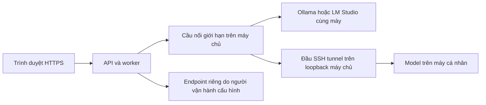

# Kế hoạch kết nối model local khi triển khai

Ngày: 2026-11-18. User yêu cầu lập kế hoạch và triển khai, chọn hỗ trợ cả hai vị trí model và cả
Ollama lẫn máy chủ tương thích OpenAI (ví dụ LM Studio). Intake #17, `US-DEPLOYED-LOCAL-MODELS`.

## Mục tiêu

Ứng dụng sau deploy dùng được model trên chính máy chủ hoặc trên máy cá nhân qua đường kết nối
riêng. Người dùng tải danh sách, chọn và kiểm tra model trong chat; model được cố định theo cuộc
trò chuyện. Ollama và `local_openai` cũng dùng được cho các tác vụ JSON qua cấu hình worker.

## Kiến trúc



1. Cùng máy: runtime model giữ trên loopback; container gọi qua bridge chỉ cho phép danh mục và
   sinh nội dung. Không mở cổng tải/xóa model hoặc đưa cổng model ra Internet.
2. Khác máy: máy cá nhân tạo SSH reverse tunnel tới loopback của máy deploy, hoặc operator cấp
   endpoint qua VPN/mạng riêng. Phần mềm model vẫn chạy trên máy cá nhân; máy đó cần đang hoạt động.
3. Trình duyệt chỉ gọi API của ứng dụng. `localhost` trong container là container đó; `localhost`
   trên máy deploy không phải máy của người đang mở web.

## Phạm vi triển khai

- Backend: provider Ollama và OpenAI-compatible local; danh sách model có giới hạn; kiểm tra JSON
  và trả lời; thời gian/dung lượng/token có trần, không theo redirect hay proxy môi trường.
- Cấu hình endpoint/key nằm trong env hoặc secret của operator. API không nhận URL từ request;
  API key máy chủ không được trả về browser. Không có migration hoặc bảng credential mới.
- API chat: POST `/chat/connections/local/models` và `/chat/connections/local/verify`, role researcher
  trở lên, CSRF/rate limit như các kết nối AI. Provider chỉ `ollama|local_openai`.
- Chat create/import cho phép `model_name` với system local provider; model phải có trong danh mục.
  Send dùng model đã lưu, lỗi khi không còn model/kết nối, không đổi sang cloud/provider khác.
- Chat/UI: lựa chọn model local, tải lại danh sách, kiểm tra trước khi tạo. Có trạng thái server
  chưa kết nối, danh sách trống, model mất, model không hỗ trợ JSON và yêu cầu quá thời gian.
- JSON enrichment/research/intake dùng model mặc định do operator cấu hình. Model local cho chat
  không tự thay embedding; Mistral/Gemini embedding hiện tại giữ cấu hình riêng.
- Compose: hồ sơ tùy chọn bridge cho cả hai giao thức; bản team chạy code đóng gói, không source
  bind mount. API/worker dùng cùng cấu hình endpoint/model/key.

## Trình tự

1. Hoàn thiện transport/adapters và schema/API, giữ ranh giới tool read/propose và duyệt bản nháp.
2. Bổ sung model picker và kiểm tra kết nối trong form chat, tái dùng phong cách giao diện hiện có.
3. Cấu hình bridge/deployment cho cùng máy và SSH/VPN tới máy cá nhân, thêm ví dụ env/runbook.
4. Test lỗi giao thức, model pinning, giới hạn, RBAC/CSRF, không lộ key, bridge whitelist; web
   unit/type/build và E2E responsive. Integration bằng model-server fixture, không giả nghiệm thu
   một trọng số model thật khi máy chưa cài model.
5. Kiểm tra runtime, cập nhật AI_LOGS/Harness, commit/push trong phạm vi đã được giao.

## Điều kiện nghiệm thu

- Tải danh sách và thử một chat từ cả hai giao thức qua cùng-host và đường tunnel được kiểm chứng.
- Model được lưu cùng phiên; đổi default hoặc mất model không làm phiên chuyển model/provider.
- Viewer/anonymous không gọi được phép thử tiêu tốn inference; secret/URL upstream không đi vào UI/log.
- Bridge chặn pull/delete/arbitrary URL/redirect; không nới quyền của AI hoặc tự xuất bản dữ liệu.
- Không tải trọng số model trên đĩa hiện tại. Chạy model thật cần model đã cài và đủ tài nguyên;
  hướng dẫn vận hành nêu riêng phần cần operator thực hiện.

## Recipe model trên máy cá nhân

Máy deploy cần SSH truy cập được bằng tài khoản/khóa có sẵn của operator. Chạy lệnh này **trên máy
cá nhân đang chạy model**, thay `operator@deploy-host` bằng địa chỉ thật:

```bash
ssh -NT -o ExitOnForwardFailure=yes -o ServerAliveInterval=30 -o ServerAliveCountMax=3 \
  -R 127.0.0.1:21434:127.0.0.1:11434 \
  -R 127.0.0.1:21234:127.0.0.1:1234 operator@deploy-host
```

Hai cổng `21434` và `21234` trên máy deploy phải còn trống. Có thể bỏ dòng `-R` của runtime không
dùng. SSH server phải cho phép remote forwarding; giữ `GatewayPorts no` để đầu tunnel chỉ nghe
loopback, không dùng `-R 0.0.0.0:...`. Lệnh giữ terminal mở; Ctrl+C sẽ đóng tunnel. Operator có thể
quản lý tiến trình bằng cơ chế service sẵn có; ứng dụng không tự tạo tài khoản/khóa SSH.

Trong `.env.team` trên **máy deploy**, giữ URL container tới bridge và đổi upstream:

```dotenv
COMPOSE_PROFILES=https,local-ai
OLLAMA_BASE_URL=http://172.17.0.1:11435
OLLAMA_BRIDGE_UPSTREAM=http://127.0.0.1:21434
LOCAL_OPENAI_BASE_URL=http://172.17.0.1:11437/v1
LOCAL_OPENAI_BRIDGE_UPSTREAM=http://127.0.0.1:21234
```

Giữ hồ sơ `tunnel` thay `https` nếu đó là lối vào hiện có; không thay domain/đăng nhập. Đặt tên
model đã cài vào `OLLAMA_MODEL`/`LOCAL_OPENAI_MODEL`; key nếu runtime yêu cầu chỉ đặt trong env/secret
trên máy deploy. Chạy `make team-config && make team-up`, rồi kiểm tra danh mục/inference theo
[runbook mục 5a](Team%20Deployment%20Runbook.md#5a-kết-nối-model-local). Với bản cục bộ, các upstream
tương tự đặt trong `.env`, dùng lệnh Compose local có hồ sơ `local-ai` ở README.

Nếu dùng VPN thay SSH, operator có thể đặt `*_BASE_URL` tới endpoint VPN riêng mà container truy cập
được, hoặc đặt `*_BRIDGE_UPSTREAM` tới origin riêng đó. Cho phép truy cập chỉ từ máy deploy bằng
firewall/VPN và dùng TLS nếu đường mạng yêu cầu. Không đưa API model ra Internet. Endpoint LM Studio
trong `LOCAL_OPENAI_BASE_URL` có hậu tố `/v1`; upstream bridge chỉ có origin, không thêm `/v1`.
`localhost` của người đang mở trình duyệt không tham gia đường kết nối này.

Recipe là hướng dẫn cấu hình, chưa phải bằng chứng SSH hoặc model thật đã được nghiệm thu. Cần ghi
riêng: protocol, vị trí model, danh mục, probe JSON và một cuộc trò chuyện thật thành công.

## Ngoài phạm vi

Không tự provision VPS/domain, đăng ký VPN, cấp SSH credential, tải model hoặc tự đổi provider mặc
định đang dùng. Không kết nối trực tiếp browser HTTPS tới HTTP localhost của từng người dùng;
đường remote dùng kết nối riêng đã nêu. KPI token toàn pipeline vẫn là công việc riêng còn mở.

## Tài liệu gốc

- [Ollama chat](https://docs.ollama.com/api/chat), [model inventory](https://docs.ollama.com/api/tags),
  [network FAQ](https://docs.ollama.com/faq).
- [LM Studio OpenAI-compatible API](https://lmstudio.ai/docs/developer/openai-compat).
- [OpenSSH remote forwarding (`ssh -R`)](https://man.openbsd.org/ssh.1#R).
