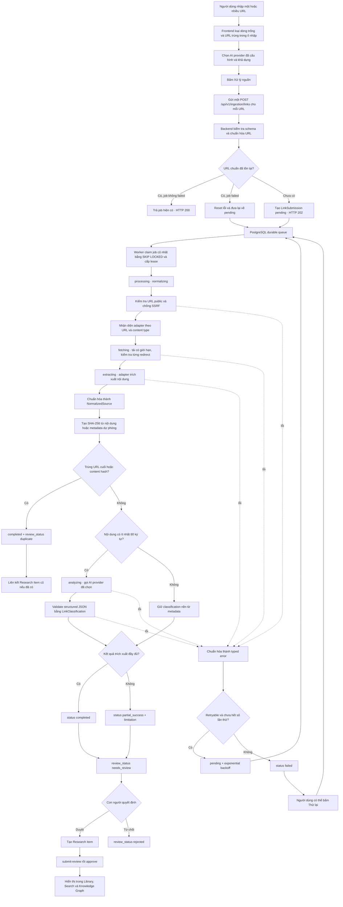

# Pipeline xử lý nguồn liên kết

## 1. Mục đích và phạm vi

Tài liệu này giải thích pipeline được kích hoạt khi người dùng bấm **“Xử lý nguồn”**
trên màn hình **Nhập liên kết** (`/ingestion`). Pipeline nhận một hoặc nhiều URL công
khai, trích xuất dữ liệu, phân loại nội dung bằng AI và đưa kết quả vào hàng kiểm duyệt
trước khi xuất bản thành Research Item.

Đây là pipeline nhập URL thủ công. Nó không phải luồng chạy RSS trên màn hình
**Bộ thu thập** (`/collector`).

Tài liệu này mô tả runtime hiện tại. Contract đích đã được chấp nhận tại
`Docs/Intake Occurrence and Receipt Specification.md`: source occurrence/receipt được tách khỏi
URL job để giữ provenance của các lần xuất hiện lặp lại. Schema/API đó chưa được triển khai và chưa
khởi động Discord Gate D.

Nguyên tắc chính:

- Mỗi URL là một job độc lập.
- API chỉ tiếp nhận và ghi job; worker thực hiện công việc nặng ở background.
- PostgreSQL là hàng đợi bền vững và source of truth.
- Mọi adapter trả về cùng một contract `NormalizedSource`.
- Trạng thái xử lý máy và trạng thái kiểm duyệt của con người được lưu riêng.
- Xử lý xong không đồng nghĩa với xuất bản; mặc định vẫn cần con người duyệt.

## 2. Flowchart tổng thể



## 3. Các bước xử lý chi tiết

### 3.1. Frontend chuẩn bị submission

Frontend thực hiện các bước nhẹ trước khi gọi API:

1. Tách nội dung textarea theo từng dòng.
2. Xóa khoảng trắng và dòng rỗng.
3. Loại URL trùng nhau trong chính lần nhập hiện tại.
4. Hiển thị nhận diện sơ bộ: GitHub, Facebook, paper, PDF, article hoặc invalid.
5. Chọn provider active đầu tiên đang được cấu hình và khả dụng.
6. Vô hiệu hóa nút nếu không có URL hoặc không có provider phù hợp.

Nhận diện ở frontend chỉ phục vụ preview. Backend vẫn là nơi quyết định adapter thật
sự sau khi đã xử lý redirect và content type.

Khi submit, frontend dùng `Promise.allSettled` để gửi từng URL độc lập. Một URL lỗi
không hủy các URL đã gửi thành công. Payload hiện tại:

```json
{
  "url": "https://example.com/article",
  "provider": "mistral",
  "source_type": "manual"
}
```

Trong lúc còn submission ở trạng thái active, frontend gọi lại danh sách job mỗi
1,5 giây để cập nhật UI.

### 3.2. API tiếp nhận và chuẩn hóa URL

Endpoint tiếp nhận:

```http
POST /api/v1/ingestion/links
```

Schema API chỉ nhận URL HTTP/HTTPS hợp lệ và provider nằm trong registry hiện hành:

- `ollama`
- `openai`
- `deepseek`
- `gemini`
- `openrouter`
- `mistral`

URL được chuẩn hóa bằng cách:

- chuyển scheme và hostname về chữ thường;
- bỏ fragment;
- bỏ port mặc định;
- gộp dấu `/` thừa và bỏ dấu `/` cuối không cần thiết;
- xóa `utm_*`, `fbclid`, `gclid` và các tracking parameter đã biết;
- sắp xếp query parameter để URL tương đương có biểu diễn ổn định.

Sau chuẩn hóa, API kiểm tra URL đã tồn tại hay chưa:

| Trường hợp | Hành vi |
|---|---|
| URL mới | Tạo `LinkSubmission` với `status=pending`, trả HTTP 202 |
| URL đã có và không failed | Trả lại submission hiện có, trả HTTP 200 |
| URL đã failed | Xóa trạng thái lỗi, reset số lần thử, áp dụng provider mới và requeue |

### 3.2.1. Source-neutral receipt trước Discord

Runtime tạo một `IntakeReceipt` cho mỗi lần xuất hiện và một receipt item cho từng URL/tài liệu,
trong khi vẫn dùng `LinkSubmission` làm processing aggregate duy nhất theo URL chuẩn hóa:

- cùng source occurrence + cùng URL chuẩn hóa: replay, không tạo receipt item/job mới;
- source occurrence khác + cùng URL: tạo provenance item mới nhưng liên kết cùng URL job;
- một occurrence có nhiều URL: mỗi URL là một item độc lập theo thứ tự first-seen;
- document/PDF: bytes phải được validate, lưu bền vững và hash-verify trước khi trả `202`;
- receipt chỉ chiếu trạng thái của job/review, không được tự approve/publish.

`POST /api/v1/intake/receipts`, endpoint upload document theo receipt và endpoint đọc trạng thái đã
được triển khai. `POST /api/v1/ingestion/links` được giữ làm compatibility endpoint và dual-write
một implicit single-item receipt; response cũ được giữ nguyên và chỉ bổ sung receipt identifiers /
disposition. Adapter bên ngoài dùng service account có scope hẹp và chỉ được thao tác trong
`source_namespace` của chính nó.

### 3.3. PostgreSQL làm durable queue

Job được lưu trong bảng `link_submissions`. Các trường quan trọng gồm:

- URL, nguồn gửi và người gửi;
- `status`, `stage` và `review_status`;
- title, Markdown đã trích xuất và content hash;
- classification;
- AI provider và model;
- attempt count, lease và lịch retry;
- typed error;
- Research Item được liên kết sau khi duyệt.

Việc dùng PostgreSQL làm hàng đợi giúp job không mất khi API hoặc worker restart.

### 3.4. Worker claim job

Worker liên tục tìm:

- job `pending` đã đến thời điểm chạy; hoặc
- job đang xử lý nhưng lease đã hết hạn.

Worker lấy job cũ nhất bằng `FOR UPDATE SKIP LOCKED`. Cơ chế này cho phép chạy nhiều
worker mà không để hai worker cùng claim một job. Khi claim thành công, worker:

1. chuyển job sang `processing`;
2. đặt stage `normalizing`;
3. tăng `attempt_count`;
4. xóa lỗi cũ;
5. cấp lease mới.

Mỗi vòng worker xử lý tối đa 10 job trước khi quay lại vòng poll.

### 3.5. Kiểm tra an toàn khi tải nguồn

Trước mỗi request và từng redirect, pipeline kiểm tra đích là URL public:

- chỉ cho HTTP/HTTPS;
- từ chối URL chứa username hoặc password;
- resolve DNS và từ chối localhost, private IP hoặc địa chỉ không global;
- không tự động follow redirect; từng redirect được lấy ra và kiểm tra lại;
- giới hạn timeout, số redirect và dung lượng tải;
- stream response và dừng ngay khi vượt giới hạn;
- từ chối content type ngoài phạm vi adapter.

Đây là lớp chống SSRF và chống tải tài nguyên không kiểm soát. Pipeline không vượt
login, paywall, quyền riêng tư hoặc giới hạn truy cập của nguồn.

### 3.6. Nhận diện và chạy source adapter

Backend nhận diện loại nguồn lần đầu từ URL, sau đó có thể nhận diện lại từ URL cuối
và `Content-Type`. Ví dụ, URL không có đuôi `.pdf` nhưng response trả
`application/pdf` vẫn được chuyển sang PDF adapter.

| Adapter | Nội dung được xử lý | Giới hạn có chủ đích |
|---|---|---|
| GitHub | Repository, README, cây file có giới hạn, file, issue và pull request công khai | Không clone không giới hạn; private/rate-limit trả typed error |
| Facebook | Open Graph metadata công khai của post/Reel/video; transcript có timestamp do researcher cung cấp | Không đăng nhập, tải media hoặc bypass anti-bot; thiếu transcript là `partial_success` |
| Paper | arXiv, DOI qua Crossref và CSL fallback, Semantic Scholar, citation metadata từ publisher | Paywall hoặc thiếu abstract vẫn giữ metadata và báo limitation |
| PDF | Xác minh PDF, đọc metadata, text layer và evidence theo trang; OCR Tesseract tùy chọn cho scan | OCR mặc định tắt và bị chặn theo page/pixel/time/output budget |
| Article | Canonical URL, title, description, author/date, heading, nội dung chính/evidence; Browserless fallback tùy chọn | Direct fetch luôn chạy trước; mọi browser subrequest phải public và image/media/font bị chặn |

### 3.7. Chuẩn hóa về `NormalizedSource`

Mọi adapter trả về cùng một contract gồm:

- `source_type` và `canonical_url`;
- title, authors và ngày xuất bản;
- description, raw text, summary và language;
- media và metadata;
- entity, claim, relationship và evidence;
- `collection_status`;
- `limitation_code` và `limitation_message` nếu chỉ trích xuất được một phần.

Một kết quả thiếu full text nhưng còn metadata hữu ích được giữ dưới dạng
`PARTIAL`. Pipeline không biến dữ liệu thiếu thành thành công hoàn toàn.

### 3.8. Chống trùng nội dung

Pipeline tạo SHA-256 từ nội dung đã trích xuất. Nếu không có text, dữ liệu dự phòng
gồm URL cuối, title và description được dùng để tạo hash.

Submission được đánh dấu trùng khi có job khác không failed thỏa một trong hai điều
kiện:

- cùng canonical URL; hoặc
- cùng content hash.

Job trùng được chuyển thành `completed` với `review_status=duplicate`. Nếu bản trước
đã có Research Item, job trùng liên kết lại Research Item đó và không gọi AI lần nữa.

### 3.8.1. Enrichment tùy chọn và source override

Hai adapter enrichment mặc định tắt và chỉ chạy sau đường trích xuất chính:

- Article chỉ thử Browserless một lần khi kết quả trực tiếp là `JS_RENDER_REQUIRED`. Browser context
  chặn service worker/download, kiểm tra URL public cho request chính và từng subrequest, chặn
  image/media/font, giới hạn timeout/wait/HTML bytes và luôn đóng context. Lỗi giữ metadata cũ cùng
  `BROWSER_RENDER_UNAVAILABLE` hoặc `BROWSER_RENDER_FAILED`.
- PDF chỉ thử Tesseract khi `pypdf` không lấy được text. PDFium render tối đa page/pixel budget,
  ảnh PNG được truyền qua stdin và text nhận từ stdout, không ghi temp file. Timeout, language,
  output chars và page count đều có giới hạn; failure giữ `OCR_UNAVAILABLE`/`OCR_FAILED` hoặc
  limitation page/text tương ứng.

Với Facebook Reel/video công khai, `PUT /api/v1/ingestion/links/{id}/transcript` nhận tối đa 500
đoạn timestamp tăng dần và tổng 120.000 ký tự. Chỉ researcher/owner được ghi và không được sửa item
đã publish. Body được lưu trong `source_overrides`, nhưng list API và audit chỉ trả language, segment
count và thời điểm cập nhật. Worker reset derived fields, requeue, overlay transcript thành evidence,
tạo lại content hash/classification và vẫn chuyển sang human review; hệ thống không tải hoặc tự
transcribe media Facebook.

### 3.9. AI structured classification

Nếu nội dung có ít nhất 80 ký tự, worker chuyển sang stage `analyzing` và gọi provider
đã chọn. Prompt gửi tối đa 30.000 ký tự và yêu cầu không bịa technologies hoặc
relations.

AI phải trả JSON đúng schema `LinkClassification`:

- content type và language;
- summary;
- concepts và technologies;
- agent patterns và business domains;
- tags và relations;
- relevance score và confidence;
- reasoning.

Kết quả được Pydantic validate trước khi lưu. JSON sai schema trở thành
`AI_RESPONSE_INVALID`; hệ thống không lưu output tự do như classification hợp lệ.

Nếu nội dung ngắn hơn 80 ký tự, AI không được gọi. Pipeline giữ classification nền
từ metadata và vẫn cho phép con người đánh giá kết quả nếu nguồn còn hữu ích.

### 3.10. Hoàn tất processing và chờ review

Sau khi trích xuất/phân loại:

- `completed`: adapter báo đã trích xuất đầy đủ;
- `partial_success`: còn dữ liệu hữu ích nhưng có limitation;
- `failed`: pipeline không thể hoàn tất;
- `duplicate`: được lưu ở `review_status` khi nội dung đã tồn tại.

Job `completed` hoặc `partial_success` thông thường được đặt
`review_status=needs_review`. Trạng thái xử lý và review độc lập với nhau để UI có
thể trả lời hai câu hỏi riêng:

1. Máy đã xử lý nguồn đến đâu?
2. Con người đã cho phép xuất bản chưa?

### 3.11. Retry và typed errors

Pipeline có hai tầng retry độc lập:

1. **Request retry:** thử lại request mạng khi timeout, rate-limit hoặc lỗi server.
2. **Durable job retry:** trả job về `pending` và đặt `next_attempt_at` theo
   exponential backoff.

Các default hiện tại:

```env
INTAKE_MAX_CONTENT_BYTES=2000000
INTAKE_MAX_PDF_BYTES=25000000
INTAKE_PDF_MAX_PAGES=80
INTAKE_REQUEST_TIMEOUT_SECONDS=20
INTAKE_REQUEST_RETRIES=2
INTAKE_MAX_REDIRECTS=5
INTAKE_MAX_ATTEMPTS=3
INTAKE_RETRY_BASE_SECONDS=30
INTAKE_JOB_LEASE_SECONDS=300
OCR_ENABLED=false
OCR_MAX_PAGES=20
OCR_DPI=200
OCR_MAX_PIXELS=20000000
OCR_TIMEOUT_SECONDS=30
OCR_MAX_OUTPUT_CHARS=120000
BROWSER_RENDER_ENABLED=false
BROWSER_RENDER_TIMEOUT_SECONDS=20
BROWSER_RENDER_WAIT_MS=500
BROWSER_RENDER_MAX_BYTES=2000000
```

Một số typed error quan trọng:

| Nhóm | Error code tiêu biểu |
|---|---|
| URL và truy cập | `INVALID_URL`, `AUTH_REQUIRED`, `ACCESS_DENIED`, `SOURCE_NOT_FOUND` |
| Network | `FETCH_TIMEOUT`, `FETCH_FAILED`, `RATE_LIMITED` |
| Giới hạn nội dung | `CONTENT_TOO_LARGE`, `UNSUPPORTED_CONTENT_TYPE` |
| Trích xuất | `EMPTY_CONTENT`, `EXTRACTION_FAILED`, `PDF_PARSE_FAILED`, `OCR_UNAVAILABLE`, `OCR_FAILED`, `BROWSER_RENDER_UNAVAILABLE`, `BROWSER_RENDER_FAILED` |
| AI provider | `AI_PROVIDER_AUTH_FAILED`, `AI_PROVIDER_RATE_LIMITED`, `AI_PROVIDER_UNAVAILABLE` |
| AI output | `AI_RESPONSE_INVALID` |
| Lỗi ngoài dự kiến | `INTERNAL_ERROR` |

Lỗi retryable và chưa hết số lần thử sẽ được schedule lại. Lỗi vĩnh viễn hoặc đã hết
số lần thử chuyển sang `failed`; người dùng có thể bấm **“Thử lại”** để reset job.

### 3.12. Human review và xuất bản

Mặc định, payload từ nút **“Xử lý nguồn”** không bật `auto_approve`. Khi người dùng
bấm **“Duyệt”**, backend:

1. lấy title, Markdown, authors, tags và classification;
2. tạo `ResearchItem` với `collection_method=auto-collected`;
3. lưu provenance gồm submission ID, source type, provider và model;
4. chuyển Research Item qua `submit-review`;
5. chuyển tiếp sang `approve`;
6. liên kết Research Item về submission.

Chỉ Research Item đã `approved` mới xuất hiện trong published library, search và
Knowledge Graph. Nếu bấm **“Từ chối”**, submission chuyển sang
`review_status=rejected` và không được xuất bản.

## 4. Hai state machine độc lập

### Processing state

```text
pending
  → processing
  → fetching
  → extracting
  → analyzing
  → completed | partial_success | failed
```

Một nguồn không đủ nội dung để gọi AI có thể bỏ qua `analyzing`. Job retryable có thể
quay từ một stage lỗi về `pending`.

### Review state

```text
not_requested
  → needs_review
  → approved | rejected

hoặc:

not_requested
  → duplicate
```

Việc tách hai state machine giúp không nhầm “máy xử lý xong” với “nội dung đã được
con người phê duyệt”.

## 5. Quan sát trên giao diện

Hàng đợi nguồn hiển thị:

- title hoặc URL;
- summary hay nội dung preview;
- source type;
- AI provider;
- processing status và review status;
- limitation của kết quả một phần;
- typed error nếu thất bại;
- các hành động Duyệt, Từ chối, Thử lại hoặc mở Research Item.

Frontend chỉ polling khi còn job ở một trong các trạng thái `pending`, `processing`,
`fetching`, `extracting` hoặc `analyzing`. Khi tất cả job đã ở trạng thái kết thúc,
polling tự dừng.

## 6. Bản đồ code

| Trách nhiệm | File chính |
|---|---|
| Form nhập URL và chọn provider | `apps/web/components/intake/intake-form.tsx` |
| Transcript Reel có timestamp | `apps/web/components/intake/submission-list.tsx` |
| Gửi từng URL và polling | `apps/web/app/ingestion/page.tsx` |
| Hiển thị queue và hành động review | `apps/web/components/intake/submission-list.tsx` |
| API submit/retry/transcript/approve/reject | `apps/api/app/api/ingestion.py` |
| Durable queue model | `apps/api/app/models.py` — `LinkSubmission` |
| Claim, process, retry, dedup và approve | `apps/api/app/services/ingestion.py` |
| Worker loop | `apps/api/app/worker.py` |
| Nhận diện adapter | `apps/api/app/services/sources/registry.py` |
| URL normalization và adapter contract | `apps/api/app/services/sources/base.py` |
| Public URL validation và bounded fetch | `apps/api/app/services/sources/http.py` |
| Browserless public render guard | `apps/api/app/services/sources/browser.py` |
| OCR PDF dùng chung | `apps/api/app/services/ocr.py` |
| Normalized source contract | `apps/api/app/schemas/source.py` |
| Structured AI providers | `apps/api/app/services/ai.py` |

## 7. Tóm tắt

Nút **“Xử lý nguồn”** không trực tiếp xuất bản nội dung. Nó tạo các job bền vững,
để worker xử lý từng nguồn theo pipeline có giới hạn:

```text
submit
→ normalize
→ detect
→ validate
→ fetch
→ extract
→ normalize document
→ deduplicate
→ classify
→ persist for review
→ human approve
→ publish to research/search/graph
```

Thiết kế này giữ cho API phản hồi nhanh, không mất job khi service restart, không tải
nguồn thiếu kiểm soát và luôn giữ human approval trước khi tri thức được xuất bản.
